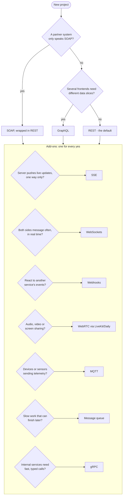

# Choose Your Stack

My personal reference for picking the right tech stack when starting a new project or refactoring an old one. Attach a guide to a Claude session (or point Claude Code at this repo) and ask it to recommend a stack using these criteria.

## Guides

Start with Reference stacks, then open the guide for each layer the project needs.

| Guide | Covers | Status |
| --- | --- | --- |
| [Reference stacks](guides/reference-stacks.md) | Stack by project type, default rule, regrets to flag | Done |
| [API styles](guides/api-styles.md) | REST, GraphQL, gRPC, SOAP, Webhooks, SSE, WebSockets, WebRTC, MQTT, message queues, mixing styles | Done |
| [Databases](guides/databases.md) | PostgreSQL, MySQL, MongoDB, SQLite, Redis | Done |
| [Frontend & mobile](guides/frontend-and-mobile.md) | Static sites, Next.js, React Native with Expo, Flutter, admin tools | Done |
| [Backend](guides/backend.md) | Languages, frameworks, backend-as-a-service | Done |
| [Hosting & deploy](guides/hosting-and-deploy.md) | Hosting, file storage, email, monitoring, secrets | Done |
| [Auth & payments](guides/auth-and-payments.md) | Managed sign-in, authorization, payment providers | Done |
| [Glossary](guides/glossary.md) | Plain-language definitions of terms used in the guides | Done |
| Vector DBs and AI infrastructure | Vector databases, model hosting, evals | Planned |

## Quick picker: API style

Pick one main API, then add a style for every "yes" below.



If every add-on question is a no, the main API is enough. Full details are in [guides/api-styles.md](guides/api-styles.md).

## How to use this repo with Claude

**In a Claude chat:** download the guides you need as `.md` files and attach them, then paste:

> Use the attached guides. Here is my project: [what it does, who uses it, web/mobile/IoT, real-time needs, team size, existing stack, new build or refactor]. Recommend a stack layer by layer (front end, back end, database, API style and add-ons, auth, hosting). Explain each choice using the guides' criteria, and flag anything I'm likely to regret later.

**In Claude Code:** clone this repo next to your projects, or add a line to a project's `CLAUDE.md`:

```
For stack decisions, follow ~/Choose-Your-Stack/guides/ and record the result in ~/Choose-Your-Stack/decisions/.
```

**From anywhere:** use the raw URL of a guide, for example
`https://raw.githubusercontent.com/SamGhaddar/Choose-Your-Stack/main/guides/reference-stacks.md`

## Recording decisions

Each time I pick a stack for a project, I copy [decisions/TEMPLATE.md](decisions/TEMPLATE.md) to `decisions/<project>.md` and fill it in. Later I can see what I chose and why, and whether it held up.

## Repo layout

```
Choose-Your-Stack/
├── README.md            this page + quick picker
├── CLAUDE.md            instructions for Claude sessions
├── guides/              one decision guide per topic
│   ├── reference-stacks.md
│   ├── api-styles.md
│   ├── databases.md
│   ├── frontend-and-mobile.md
│   ├── backend.md
│   ├── hosting-and-deploy.md
│   ├── auth-and-payments.md
│   └── glossary.md
├── decisions/           one record per project
│   ├── README.md
│   └── TEMPLATE.md
└── .github/ISSUE_TEMPLATE/
    └── new-guide.md     track a guide to write next
```
